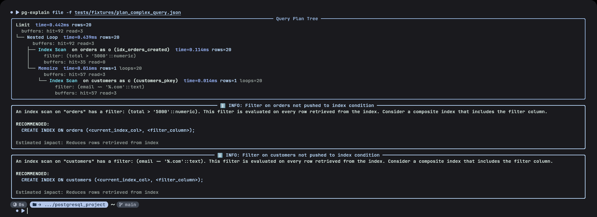

# pg-explain



[](https://github.com/UTMOS12345/pg-explain/actions/workflows/ci.yml)
[](LICENSE)

> Find out why your PostgreSQL query is slow, right in your terminal.

pg-explain runs `EXPLAIN (ANALYZE, BUFFERS)` on your query, draws the plan as a colour tree, and flags the nodes that are slow, each with a suggested fix. It can also check the health of the whole database and show live activity, so you don't have to leave the terminal or paste plans into a website.

## Table of Contents

- [Security](#security)
- [Background](#background)
- [Install](#install)
- [Usage](#usage)
- [Diagnostic rules](#diagnostic-rules)
- [How it works](#how-it-works)
- [Development](#development)
- [Roadmap](#roadmap)
- [Maintainers](#maintainers)
- [Contributing](#contributing)
- [License](#license)

## Security

`pg-explain query` runs `EXPLAIN ANALYZE`, which **really executes the statement**. pg-explain never commits the transaction, so `INSERT`, `UPDATE` and `DELETE` are rolled back, but locks are still taken and triggers still fire while the query runs.

- Don't run write queries against a production database. Use a copy or a staging database.
- To see a plan without executing anything, run `EXPLAIN (ANALYZE, BUFFERS, FORMAT JSON)` yourself where it's safe, and pass the result to `pg-explain file`.
- Use a read-only database role when you can.

## Background

Raw `EXPLAIN ANALYZE` output is a wall of text, and the slow part is easy to miss. Web visualizers like [PEV2](https://github.com/dalibo/pev2) draw the plan nicely, but you have to copy it out of the terminal, and they show you *what* happened, not *what to change*.

pg-explain keeps the whole loop in the terminal: run the query, see the plan, get a list of problems with concrete fixes (`CREATE INDEX …`, `SET work_mem …`).

### See Also

- [PEV2](https://github.com/dalibo/pev2): web-based plan visualizer
- [explain.depesz.com](https://explain.depesz.com): the classic online plan analyzer
- [pg_activity](https://github.com/dalibo/pg_activity): `top`-like activity monitor for PostgreSQL
- [pgcenter](https://github.com/lesovsky/pgcenter): command-line admin and stats tool

## Install

```bash
pip install git+https://github.com/UTMOS12345/pg-explain
```

### Dependencies

- Python 3.11+
- PostgreSQL 13+
- The [`pg_stat_statements`](https://www.postgresql.org/docs/current/pgstatstatements.html) extension (optional; `diagnose` uses it to find the slowest queries)

## Usage

```bash
# Analyze a query
pg-explain query -d postgresql://user@localhost/shop -q "SELECT * FROM orders WHERE total > 5000"
```

### CLI

| Command | What it does |
|---|---|
| `query` | Runs `EXPLAIN (ANALYZE, BUFFERS)` on a query and shows the plan tree and issues |
| `file` | Analyzes a saved plan (`EXPLAIN (ANALYZE, BUFFERS, FORMAT JSON)` output) without touching a database |
| `diagnose` | Database health overview: slowest queries, unused indexes, table sizes |
| `watch` | Live view of active queries and locks |

```bash
# Analyze a saved plan, as text or JSON
pg-explain file -f plan.json
pg-explain file -f plan.json --json

# Save an HTML report
pg-explain query -d $DATABASE_URL -q "SELECT ..." --save report.html

# Database health overview
pg-explain diagnose -d $DATABASE_URL

# Live activity, refreshed every 2 seconds
pg-explain watch -d $DATABASE_URL --interval 2
```

Run `pg-explain <command> --help` for all options.

## Diagnostic rules

Each node in the plan tree shows time, rows, loops and buffer hits/reads. On top of that, 10 rules look for common problems:

| Rule | What it means | Typical fix |
|---|---|---|
| Large sequential scan | Reads the whole table to return a few rows | Index the filtered column |
| Sort spills to disk | The sort didn't fit in memory | Raise `work_mem` for this query |
| Row-estimate drift | The planner's row guess is far off, so it may choose a bad plan | `ANALYZE` the table, or add extended statistics |
| Nested loop over seq scan | The inner table is scanned again for every outer row | Index the join column |
| Materialized CTE | The CTE is computed in full instead of being inlined | `NOT MATERIALIZED`, or rewrite as a subquery |
| Missed parallelism | A large scan ran without parallel workers | Check `max_parallel_workers_per_gather` |
| Bitmap scan, few rows | A bitmap scan returns only a few rows | A plain index scan may be cheaper |
| Filter not pushed to index | Rows are fetched through the index, then filtered | Composite index that includes the filter column |
| Index-only scan possible | The index almost covers the query | Add the missing columns with `INCLUDE (...)` |
| Sort could use index | Sorting on a column that already has an index | Index in the `ORDER BY` order |

## How it works

```
EXPLAIN JSON ─▶ parser ─▶ PlanNode tree ─▶ rule engine ─▶ Rich renderers (tree, diagnostics, dashboard)
```

- `models.py`: a typed `PlanNode` dataclass parsed from PostgreSQL's JSON plan format
- `rules.py`: each rule is a small function `(node, root) -> list[Issue]`; the analyzer walks the tree and removes duplicate issues
- `collectors/`: queries against `pg_stat_statements`, `pg_stat_user_indexes`, `pg_locks` and `pg_stat_activity`

## Development

```bash
python -m venv .venv && source .venv/bin/activate
pip install -e . pytest
pytest -q
```

The test suite has 45 unit tests that run against real plan fixtures, so no database is needed. To add a rule, write a function in `rules.py` and add a plan fixture that triggers it.

## Roadmap

- [ ] Per-node *exclusive* time and hot-path highlighting
- [ ] Verify index suggestions with hypothetical indexes ([HypoPG](https://github.com/HypoPG/hypopg))
- [ ] Before/after plan comparison (`pg-explain compare`)
- [ ] `--fail-on critical` exit codes for CI pipelines
- [ ] More accurate bloat estimation (`pgstattuple`, dead tuples)
- [ ] Smarter rules (rows scanned vs returned, `pg_trgm` hints for `LIKE '%…'`)
- [ ] Publish to PyPI

## Maintainers

[@UTMOS12345](https://github.com/UTMOS12345)

## Contributing

Questions and bug reports are welcome in [Issues](https://github.com/UTMOS12345/pg-explain/issues). If a plan confuses pg-explain or a rule gives a wrong suggestion, please attach the `EXPLAIN (ANALYZE, BUFFERS, FORMAT JSON)` output.

Pull requests are welcome. For a new rule, include a plan fixture and a test, and make sure `pytest -q` passes.

## License

[MIT](LICENSE) © Imomaliyev Maksudali
